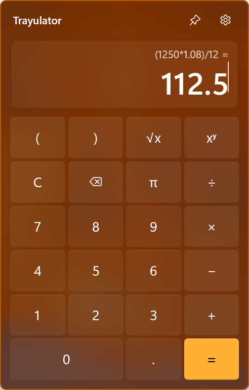

# Trayulator

A small calculator that lives in the Windows notification area. Click the tray icon, type an equation, press Enter.



## Features

- **Type or tap.** The display is a real text box, so you can type whole equations such as `(1250*1.08)/12` or use the keypad. Keys insert at the cursor.
- **Evaluate in place.** Enter, typing `=`, or the **=** key replaces the equation with its result, and the equation moves to the line above, like Windows Calculator.
- **Keep going.** After a result, an operator continues from it and a number starts over. `ans` is the previous result, and **Up** brings back the last equation to edit.
- **History.** The history button (or Ctrl+H) slides a list of this session's equations up over the keypad. Pick one to load it back into the entry.
- **Pin it open.** The pin button keeps the flyout on screen when you click elsewhere. Escape or the tray icon still hides it.
- **Copy on evaluate.** An optional setting puts every result on the clipboard.
- **Light on resources.** It does no work while hidden, needs no network access, and follows the taskbar's light or dark theme and accent color.

## What you can type

| Input | Meaning |
|---|---|
| `+ - * /` or `× − ÷` | Arithmetic |
| `^` or `**` | Power: `2^10` = 1024 |
| `%` | Remainder: `10 % 3` = 1 |
| `( )` | Grouping |
| `pi` or `π`, `e` | Constants. `2π` works too |
| `ans` | The previous result |
| `sqrt(x)`, `abs(x)`, `round(x, n)`, `pow(x, y)`, `max(a, b)`, `min(a, b)`, `log(x, base)`, `ln(x)`, `log10(x)`, `exp(x)` | Functions, case-insensitive |
| `sin`, `cos`, `tan`, `asin`, `acos`, `atan`, `atan2(y, x)` | Trigonometry, in radians |
| `floor`, `ceiling`, `truncate`, `sign`, `ieeeremainder(x, y)` | Rounding and signs |

Numbers use `.` for decimals and `,` between function arguments. Results are shown to 15 significant digits, so `0.1+0.2` is `0.3`. Whole numbers that overflow switch to floating point instead of wrapping around.

## Keyboard

| Key | Action |
|---|---|
| Enter or `=` | Evaluate |
| Up | Recall the last equation |
| Ctrl+H | Show or hide history |
| Escape | Leave settings or history, or hide the flyout |
| Alt+Left or the mouse's back button | Leave settings or history |

## Build and run

Runs on Windows 10 1809 or later, x64 or ARM64. The acrylic backdrop needs Windows 11 22H2; earlier versions get a solid background.

Building needs [Rust](https://rustup.rs) with the MSVC toolchain (Visual Studio's C++ build tools for your architecture) and the [winapp CLI](https://github.com/microsoft/winappCli) (`winget install Microsoft.WinAppCli`).

```powershell
.\run.ps1            # build, register with package identity, and launch
.\run.ps1 -Clean     # same, starting from first-run state
cargo test           # engine, history and editing tests
```

`cargo run` also works, but unpackaged: settings don't persist and **Start with Windows** is unavailable.

`.\build-msix-for-gh.ps1` builds signed x64 and ARM64 MSIX packages into `AppPackages\GitHub` and drafts a GitHub release with them (`-SkipRelease` stops after signing). It needs both Rust targets (`rustup target add x86_64-pc-windows-msvc aarch64-pc-windows-msvc`) and the maintainer's `sign-msix` PowerShell function. The release tag comes from the version in `Package.appxmanifest`, which must match `Cargo.toml`.

Right-click the tray icon for **Settings** and **Exit**.

## How it's built

- Rust and [windows-rs](https://github.com/microsoft/windows-rs): a Win32 tray icon and one popup window, drawn with Direct2D and DirectWrite over the shell's acrylic backdrop and styled after the WinUI controls. UI Automation providers expose every control to Narrator.
- Expressions are parsed and evaluated in `src/calc/engine.rs`, which has no Windows dependency. Whole numbers stay exact until they overflow; division and powers are real.
- The flyout (`src/ui/flyout.rs`) hides when dismissed, so reopening it is instant. After a minute hidden it closes completely, and the idle app drops to about 1 MB of working set.
- Settings live in the package's LocalSettings and the history in memory, so the history lasts until you exit.
